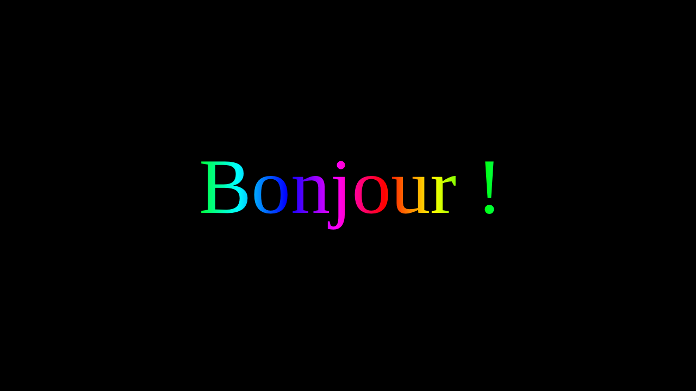

# Bonjour!

Application homebrew **native** pour Nintendo Switch : un écran entièrement noir, puis
« Bonjour ! » qui s'écrit lettre par lettre en **Times New Roman**, avec un dégradé
**RGB animé en continu**.



- Écran noir pur `#000000`, aucun menu, aucun logo, aucun bouton.
- Texte unique, « Bonjour ! », parfaitement centré horizontalement et verticalement.
- Effet machine à écrire : pause, puis une lettre à la fois, avec un léger fondu.
- Dégradé arc-en-ciel (rouge, orange, jaune, vert, cyan, bleu, violet, rose) qui glisse
  de gauche à droite en boucle, sans jamais s'arrêter ni faire disparaître le texte.
- C++17, libnx, rendu natif sur le framebuffer de la console (aucune dépendance à
  l'exécution, aucun accès réseau).
- Compatible Atmosphère / hbmenu, quitte proprement avec `+` ou via le bouton HOME.

---

## 1. Compilation

Le projet se compile avec **devkitPro / devkitA64 / libnx**, exactement comme les
homebrews officiels. Le livrable est `Bonjour.nro`.

### Option A — Docker (recommandée, reproductible)

L'image officielle contient tout le nécessaire :

```bash
git clone https://github.com/ClmentCch/Bonjour-.git
cd Bonjour-

docker run --rm -v "$PWD:/project" -w /project devkitpro/devkita64:latest make -j"$(nproc)"
```

`Bonjour.nro` apparaît à la racine du dépôt.

### Option B — devkitPro installé localement

1. Installer devkitPro (pacman) : <https://devkitPro.org/wiki/Getting_Started>
   puis les paquets Switch :

   ```bash
   sudo dkp-pacman -S switch-dev
   ```

2. Exporter l'environnement (généralement déjà fait par `/etc/profile.d/devkit-env.sh`) :

   ```bash
   export DEVKITPRO=/opt/devkitpro
   export DEVKITARM=$DEVKITPRO/devkitARM
   export DEVKITA64=$DEVKITPRO/devkitA64
   ```

3. Compiler :

   ```bash
   make -j"$(nproc)"
   ```

   Cibles utiles : `make clean` (supprime `build/` et les artefacts).

### Option C — GitHub Actions

Chaque push sur `main` déclenche `.github/workflows/build.yml` : installation de
l'environnement devkitPro (image officielle `devkitpro/devkita64`), compilation,
vérification de l'en-tête du NRO, puis publication de `Bonjour.nro` comme artefact
téléchargeable (`Actions` → run → `Artifacts` → `Bonjour-nro`).

### Ce que produit la compilation

| Fichier | Rôle |
|---|---|
| `Bonjour.nro` | **Livrable** : application homebrew à copier sur la carte SD |
| `Bonjour.nacp` | Métadonnées (titre, auteur, version) intégrées au NRO |
| `Bonjour.elf` | Binaire intermédiaire (débogage) |

---

## 2. Installation sur la Nintendo Switch

Prérequis : une console compatible homebrew avec **Atmosphère** et le **hbmenu**
(Homebrew Menu), et une carte SD.

1. Récupérer `Bonjour.nro` (Release `1.0.0` ou artefact de build).
2. Copier le fichier sur la carte SD :

   ```
   SD:/switch/Bonjour.nro
   ```

3. Réinsérer la carte SD, lancer la console.
4. Ouvrir le Homebrew Menu :
   - depuis le menu HOME via l'album (si le lancement d'applet est autorisé), ou
   - en maintenant `R` au lancement d'un jeu (mode « title override », recommandé).
5. Sélectionner **Bonjour** dans la liste.

### Contrôles

| Touche | Action |
|---|---|
| `+` | Quitter l'application |
| `HOME` | Comportement système normal (Atmosphère reprend la main) |

L'application ne nécessite **aucune connexion Internet** et **aucune bibliothèque
externe** : tout est lié statiquement dans le NRO.

---

## 3. Police : Times New Roman et licences

La police demandée est **Times New Roman Regular**, une police **propriétaire
(Monotype)** qui **ne peut pas être redistribuée** dans un dépôt public. Le dépôt ne la
contient donc pas et l'application est livrée avec un substitut légal aux **métriques
identiques** : [Liberation Serif](https://github.com/liberationfonts/liberation-fonts)
(SIL Open Font License 1.1), dessiné pour être compatible Times New Roman.

Trois façons d'obtenir un rendu **Times New Roman authentique** :

### 3.1 Sans recompiler (le plus simple)

Copier votre propre fichier Times New Roman sur la carte SD :

```
SD:/switch/Bonjour/times.ttf
```

L'application le détecte au démarrage et l'utilise à la place de la police embarquée
(chemin recherché : `sdmc:/switch/Bonjour/times.ttf`). Aucune recompilation nécessaire.

### 3.2 En compilant avec votre fichier

Placer votre copie légale ici :

```
assets/fonts/times.ttf
```

Le `Makefile` la détecte automatiquement et l'embarque **dans** le NRO
(`-DBONJOUR_FONT_IS_TIMES=1`). Ce fichier est exclu par `.gitignore` : il ne sera jamais
commité.

### 3.3 Police embarquée par défaut

Sans `times.ttf`, le binaire embarque `assets/fonts/LiberationSerif-Regular.ttf`
(OFL, redistribuable, licence incluse dans `assets/fonts/LICENSE-Liberation.txt`).

> Le rendu livré dans la Release utilise donc Liberation Serif, pas Times New Roman :
> c'est la seule option légale pour un binaire public. Voir `assets/fonts/README.md`.

---

## 4. À propos du fichier NSP

Un `.nsp` installable sur le menu HOME est un conteneur **signé** : sa production exige
les clés privées de la console (`prod.keys`, `title.keys`) et une clé de signature, qui
ne sont **pas** fournies ici et ne doivent jamais être publiées dans un dépôt.

Ce projet ne demande ni ne stocke aucune clé, et ne fournit donc **pas** de `Bonjour.nsp`.
Le `.nro` est le livrable officiel et prioritaire de cette application : il s'exécute
comme application homebrew à part entière, sans forwarder ni raccourci.

---

## 5. Organisation du projet

```
Bonjour-/
├── src/
│   ├── main.cpp            # init libnx, framebuffer, boucle, événements, sortie
│   ├── animation.cpp       # temporisation de l'effet machine à écrire
│   └── renderer.cpp        # rasterisation TrueType + dégradé RGB animé
├── include/
│   ├── animation.hpp
│   └── renderer.hpp
├── vendor/
│   └── stb_truetype.h      # rasteriseur TrueType (domaine public)
├── assets/
│   ├── fonts/
│   │   ├── LiberationSerif-Regular.ttf   # substitut légal (OFL)
│   │   ├── LICENSE-Liberation.txt
│   │   └── README.md
│   └── icon.jpg            # icône 256x256 du menu HOME
├── tools/
│   ├── make_icon.py        # régénère assets/icon.jpg
│   └── render_preview.cpp  # vérification hors console (rendu + contrôles)
├── docs/preview.png
├── .github/workflows/build.yml
├── Makefile
├── LICENSE
└── README.md
```

### Choix technique du rendu

Le rendu se fait **directement sur le framebuffer de la console** (libnx
`framebufferCreate` / `framebufferBegin`), en `RGBX_8888`, plutôt que via SDL2 :

- zéro dépendance à l'exécution, aucun contexte GPU/EGL à initialiser ;
- contrôle exact du pixel, indispensable pour un dégradé par colonne et un
  anti-crénelage propre ;
- démarrage immédiat et très stable en mode applet comme en mode application.

La police est rasterisée par stb_truetype (embarqué), ce qui évite toute dépendance à
FreeType/SDL_ttf tout en gardant un rendu TrueType fidèle (crénage inclus).

---

## 6. Vérifications effectuées

Compilation réelle avec devkitA64 GCC 15.2.0 + libnx (même image que la CI) :

- `make` produit `Bonjour.nro` (703 069 octets) avec l'en-tête `HOMEBREW` + `NRO0`
  (vérifié par `xxd` et par le workflow) et un NACP valide (`Bonjour!`, `1.0.0`).
- `tools/render_preview.cpp` compile **le même code** `renderer.cpp` / `animation.cpp`
  sur PC et vérifie 18 points, tous validés :
  police TrueType analysée, texte composé, boîte d'encre (539×127 px) centrée
  horizontalement et verticalement, écran noir avant la première lettre, apparition
  progressive de gauche à droite, texte complet puis stable (aucune disparition, aucune
  dérive), dégradé en mouvement, déplacement vers la droite à la vitesse attendue
  (64 px mesurés pour 65 px théoriques sur 0,5 s), bouclage continu.

**Non vérifié :** l'exécution sur une Nintendo Switch physique (aucune console
disponible dans l'environnement de développement). Le NRO a été validé par compilation,
par analyse de son en-tête et par vérification du rendu hors console ; le test matériel
final reste à faire sur votre console.

---

## 7. Régénérer les ressources

```bash
python3 tools/make_icon.py     # icône 256x256 (nécessite Pillow)
```

Vérification hors console du rendu :

```bash
g++ -std=c++17 -O2 -Iinclude -Ivendor tools/render_preview.cpp \
    src/renderer.cpp src/animation.cpp -o render_preview
./render_preview assets/fonts/LiberationSerif-Regular.ttf /tmp/frames
```

---

## 8. Licence

Code de l'application : **MIT**, voir [LICENSE](LICENSE).

Composants tiers :

- `vendor/stb_truetype.h` — domaine public / MIT (Sean Barrett).
- `assets/fonts/LiberationSerif-Regular.ttf` — SIL Open Font License 1.1.
- libnx — ISC.

Times New Roman est une marque de Monotype ; aucun fichier de cette police n'est
distribué dans ce dépôt.
